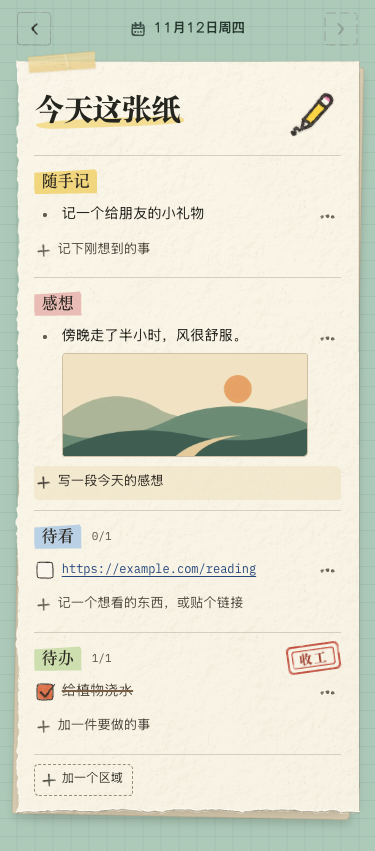

<p align="center"></p>

<h1 align="center">今天这张纸</h1>

<p align="center">一张放在 Chrome 和 Firefox 侧栏里的手绘便签。看到什么、想到什么，顺手记在今天这页。</p>

<p align="center"><a href="https://github.com/SparkChase/today-paper/releases/latest">下载 Chrome 扩展</a> · <a href="#安装">安装</a> · <a href="#本地开发">本地开发</a></p>

<p align="center"></p>

## 用法

- **随手记、感想、待看、待办**。一张纸上可以同时写段落、存链接和列清单。还可以添加自己的文字区或勾选区，之后每天沿用。
- **直接贴图**。复制一张图或截屏，在记录的输入框按 `⌘V` 或 `Ctrl+V`。预览出现后点「记下」。可以加说明，也可以只贴图。
- **每天换页**。点日期或左右箭头查看过去的纸。需要接着做的事可以「抄到今天」，图片会一起带过来。
- **备份与导入**。导出一个包含文字、图片和勾选状态的 JSON 文件。在另一台设备或另一款受支持的浏览器中导入，预览后即可合并。也支持早期通过控制台导出的 JSON。
- **分享这页**。勾选想分享的分区，预览、复制或下载一张手绘长图。
- **本地保存**。文字、链接和图片都保存在当前浏览器的用户资料中，离线也能使用。扩展只在你粘贴时接收剪贴板里的图片。

## 安装

### Chrome

适用于桌面 Chrome 116 及更新版本。

1. 在 [Releases](https://github.com/SparkChase/today-paper/releases/latest) 下载 `today-paper-chrome.zip` 并解压。
2. 打开 `chrome://extensions`，开启右上角的「开发者模式」。
3. 点击「加载已解压的扩展程序」，选择包含 `manifest.json` 的 `today-paper` 文件夹。
4. 在 Chrome 工具栏的扩展菜单打开「今天这张纸」。固定图标后，点一下就能打开侧栏。

升级时，把新包的文件覆盖到原先加载的文件夹，再到扩展管理页点「重新加载」。保留原来的扩展和路径即可继续使用原有记录。换电脑或改用商店版时，可先导出，再在新安装的扩展中导入。

### Firefox

适用于桌面 Firefox 140 及更新版本。当前可[构建并临时加载 Firefox 版](docs/firefox-add-ons.md)。从 Chrome 搬笔记时，在旧侧栏点「备份与导入 → 导出备份」，再用 Firefox 版的「选择备份文件」预览并合并。

## 本地开发

使用 Node.js 22.12+、React、Vite 和 WebExtensions Manifest V3。

```sh
npm ci
npm run build
```

在 Chrome 中加载生成的 `dist/`。改动后重新构建，再到扩展管理页点「重新加载」。

```sh
npm run test:chrome
```

浏览器测试使用独立的 Chrome 用户资料，覆盖贴图、历史翻页、备份恢复、PNG 分享和并发写入。macOS 和 Linux 可以设 `HEADED=1` 额外检查工具栏能否打开原生侧栏。Chrome 安装在其他位置时，通过 `CHROME_PATH` 指定可执行文件。

## 存储与许可

扩展使用浏览器本地存储。图片会转成 WebP，长边超过 2200 像素时等比缩小。移除扩展会清除它在当前浏览器用户资料中的数据。详见[隐私说明](docs/privacy.md)。

纸张、插画、手绘组件和 Kevin Sans 来自 [Looseleaf](https://github.com/kevintngo/looseleaf)，采用 [MIT 许可](public/LICENSE.Looseleaf.txt)。IBM Plex Mono 采用 [SIL OFL 1.1](public/LICENSE.IBM-Plex-Mono.txt)。其他依赖的许可见 [第三方声明](public/THIRD-PARTY-NOTICES.txt)。
